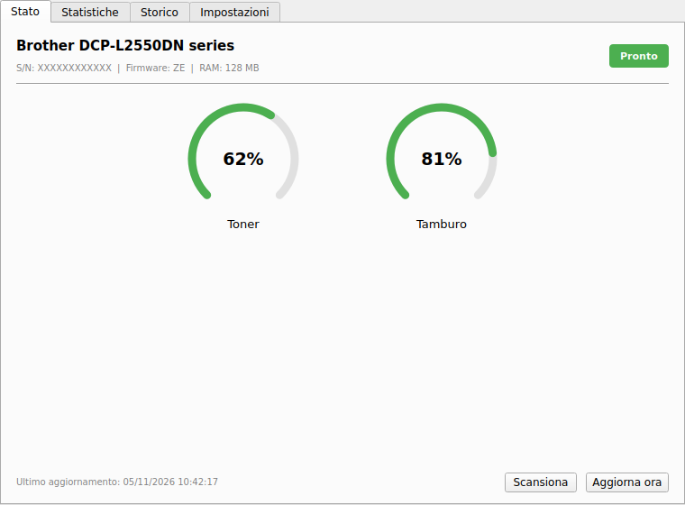
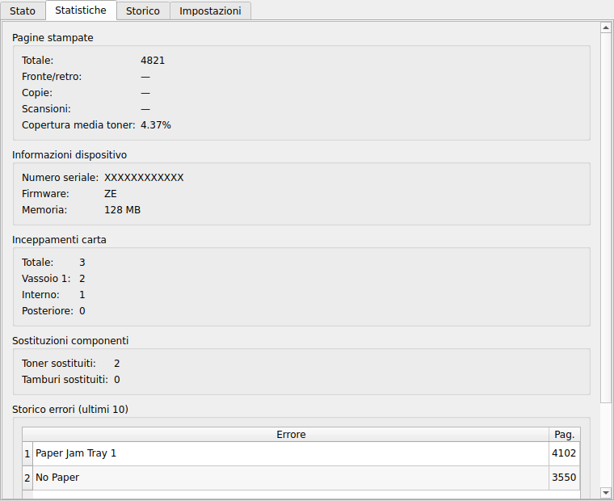

# Printer Monitor

A **Linux system tray monitor for printers**: toner and drum levels, page counters, paper jams, error log and desktop notifications when consumables run low.

- **Brother printers connected via USB** — read through [`ipp-usb`](https://github.com/OpenPrinting/ipp-usb), which exposes the printer's built-in web UI on `localhost`. Most printer monitors assume a network printer; this one works with the cable.
- **Any network printer via SNMP** — standard Printer MIB (RFC 3805), not Brother-specific.

It only monitors: printing itself is CUPS's job (see [Printing](#printing-not-what-this-app-does--read-this-first)).

[](https://github.com/GabryXnLab/brother-monitor/actions/workflows/ci.yml)


| Status | Statistics |
|---|---|
|  |  |

The interface is currently in Italian.

## Supported printers

| Driver | Printers | Status |
|---|---|---|
| `brother_http` (USB via `ipp-usb`, or a network Brother) | Brother DCP-L2550DN | tested |
| `brother_http` | other Brother laser models with the same web UI (`/general/information.html`) | likely, untested |
| `snmp` | any printer exposing the standard Printer MIB | toner, drum, status |

The Brother driver parses the printer's web page, so a model with a different
layout may show missing values. If yours does, please open a
[new printer model issue](https://github.com/GabryXnLab/brother-monitor/issues/new?template=new_printer_model.yml)
with the page HTML attached: it becomes a test fixture and the model gets supported.

## Features

- System tray icon with color-coded status (green/yellow/red)
- Real-time toner and drum percentage gauges
- Print counter history with SQLite storage
- Desktop notifications when consumables run low
- Multi-printer support (add as many printers as you need)
- Two driver backends: **Brother HTTP** (web interface scraping) and **SNMP**
- Configurable polling interval and notification thresholds per printer

## Requirements

- Linux with a graphical session (X11 or Wayland via XWayland)
- Python 3.11+
- [`uv`](https://docs.astral.sh/uv/) (or `pipx`) — `install.sh` and development use `uv`
- On GNOME: the [AppIndicator and KStatusNotifierItem Support](https://extensions.gnome.org/extension/615/appindicator-support/) shell extension, since GNOME does not expose a system tray natively

## Installation

### As a user tool (recommended)

```bash
uv tool install git+https://github.com/GabryXnLab/brother-monitor   # or: pipx install git+https://github.com/GabryXnLab/brother-monitor
printer-monitor
```

To start it at login, tick *Impostazioni → Avvia automaticamente al login* in the app.

### System-wide, with auto-start on USB plug-in

```bash
git clone https://github.com/GabryXnLab/brother-monitor.git
cd brother-monitor
bash install.sh
```

This installs to `/usr/local/lib/printer-monitor`, creates a dedicated venv there via `uv sync` (so no system Python packages are needed), and adds a `printer-monitor` binary to your `$PATH`. It also sets up an XDG autostart entry, a systemd user service and a udev rule that starts the monitor when a Brother USB printer is plugged in.

### GNOME

GNOME has no system tray by default; install the extension so the icon is visible:

```bash
sudo dnf install -y gnome-shell-extension-appindicator   # Fedora; use your distro's package manager otherwise
gnome-extensions enable appindicatorsupport@rgcjonas.gmail.com
```

then log out and back in.

### Development setup

```bash
git clone https://github.com/GabryXnLab/brother-monitor.git
cd brother-monitor
uv sync --dev
uv run printer-monitor
```

## Printing (not what this app does — read this first)

This app **monitors** toner/drum/status; it does not make the printer appear in
your browser's or apps' print dialog. That's CUPS's job.

If your Brother printer is connected via USB and you only see "Save as PDF" in
print dialogs, it's almost always because the printer was never registered as a
CUPS queue — `ipp-usb` alone just exposes it on `localhost`, it doesn't add it
to CUPS. On a modern distro (CUPS 2.3+) you don't need Brother's proprietary
driver: register it once with IPP Everywhere (driverless):

```bash
systemctl status ipp-usb        # should be active; started automatically via udev when the printer is plugged in
sudo lpadmin -p Brother -E -v "ipp://localhost:60000/ipp/print" -m everywhere
lpoptions -d Brother            # optional: make it your default
```

Then it will show up in any print dialog. If it doesn't appear via mDNS/AirPrint
discovery instead, `lpinfo -v | grep ipp` shows the exact URI ipp-usb advertises
(port may differ from 60000 if you have multiple USB printers).

### No print quality / DPI option in the browser's quick print panel

Chrome/Vivaldi/Chromium-based browsers on Linux have a fixed, hardcoded set of
fields in their own quick print panel (paper size, pages per sheet, scale,
duplex) — print quality/DPI/media type are **not** among them, on any distro
or desktop environment. Those driver-specific options only exist in the full
OS print dialog, reachable via "Print using system dialog..." /
`Ctrl+Shift+P`. This has always been true; it's not something this project's
CUPS setup can change. There, `cupsPrintQuality` (Draft/Normal/High, mapped by
the driverless queue to 300/600/1200dpi) is available (`lpoptions -p <queue> -l`
lists it).

Chromium-based browsers do support an enterprise policy
(`PrintPreviewDisabled`) that skips the quick panel entirely and opens the
system dialog directly on every `Ctrl+P` — useful if you want driver options
without the extra step, at the cost of losing the quick panel. Not applied by
default in this repo; see the [Vivaldi forum thread](https://forum.vivaldi.net/topic/41862/restoring-print-using-system-dialog)
if you want to set it up yourself.

## Configuration

On first launch, a default config is created at `~/.config/printer-monitor/config.yaml`.

Example config:

```yaml
printers:
  - name: Brother DCP-L2550DN
    driver: brother_http
    url: http://localhost:60000
    cups_printer: Brother_DCP_L2550DN
    polling_interval_sec: 60
    notifications:
      enabled: true
      toner_threshold: 20   # notify when toner drops below this %
      drum_threshold: 15    # notify when drum drops below this %

  - name: Office Printer
    driver: snmp
    host: 192.168.1.50
    community: public
    polling_interval_sec: 120
    notifications:
      enabled: true
      toner_threshold: 10
      drum_threshold: 10
```

### Brother HTTP driver

Used for Brother printers connected via USB and exposed through `ipp-usb` (typically at `http://localhost:60000`). Scrapes the printer's built-in web interface.

### SNMP driver

Used for network printers that expose consumable data via SNMP. Set `host` to the printer's IP and `community` to the SNMP community string (usually `public`).

## Running tests

```bash
uv run pytest
```

Tests run headless (no display required) via `QT_QPA_PLATFORM=offscreen`.

## Project structure

```
printer_monitor/
  app.py             — entry point (`printer-monitor`), wires Qt components together
  config.py          — YAML config loader/saver
  history.py         — SQLite history storage
  tray.py            — system tray icon and notifications
  main_window.py     — main 4-tab window (Status / Stats / History / Settings)
  widgets.py         — CircularGauge custom widget
  drivers/
    base.py          — PrinterDriver ABC and PrinterData dataclass
    brother_http.py  — Brother web interface scraper
    snmp.py          — SNMP polling driver
brother_monitor.py   — compatibility shim for `python brother_monitor.py`
tests/               — pytest test suite
```

## License

[MIT](LICENSE)
